<div align="center">

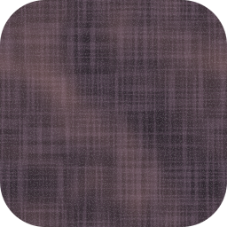

# ЗЕРНО

**Бесшовные шумовые плитки для фона — зерно, бумага, бетон, плёнка, шёлк.**<br>
Небольшое быстрое настольное приложение: собираете фактуру с живым превью и выгружаете плитку без видимого стыка.

[](https://github.com/sibkit/zerno/releases/latest)
[](LICENSE)


[English](README.md) · **Русский**

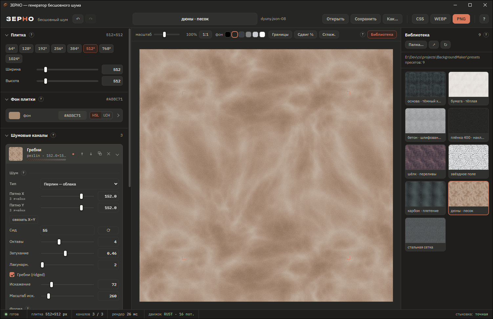

</div>

## Зачем это

Сплошная заливка выглядит дёшево, фото-текстура тяжёлая и повторяется с заметным
швом. **ЗЕРНО** делает середину между ними: тонкую процедурную фактуру в виде
маленькой плитки от 64 до 4096 px. Её кладут под `background-repeat` на сайте,
в интерфейсе приложения, в презентации, в меню игры.

Плитка бесшовна **по построению**, а не за счёт размытых краёв: каждое шумовое
поле строится на решётке с целым числом ячеек на плитку, поэтому правый край
математически равен левому, нижний — верхнему (подробно — ниже, «Как устроена
бесшовность»). Движок на Rust, оболочка — Tauri 2 (WebView2).

<p align="center">
  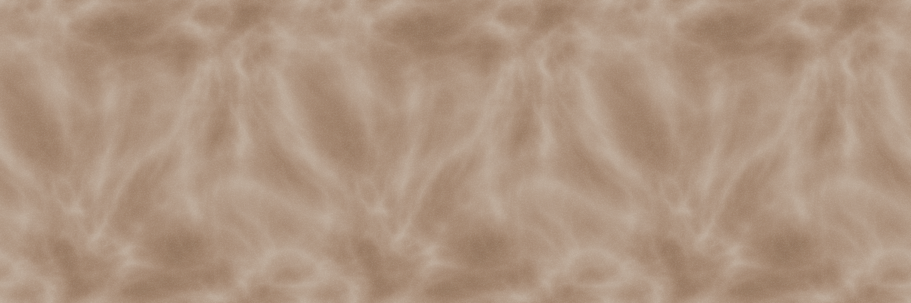
  <br><sub>Три копии одной плитки 512 × 512 подряд. Попробуйте найти стыки.</sub>
</p>

Пресеты из комплекта, каждый — одна плитка:

<table>
  <tr>
    <td align="center">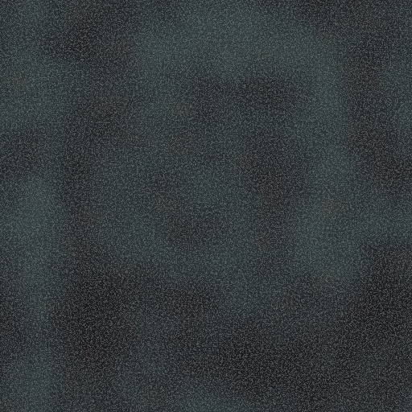<br><sub>основа · тёмный холст</sub></td>
    <td align="center">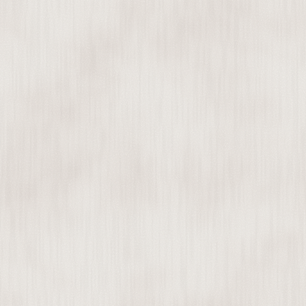<br><sub>бумага · тёплая</sub></td>
    <td align="center">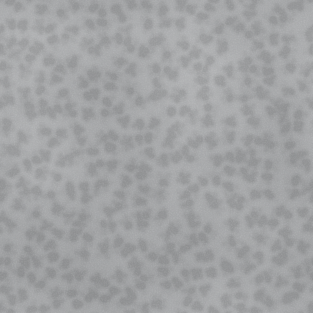<br><sub>бетон · шлифованный</sub></td>
  </tr>
  <tr>
    <td align="center">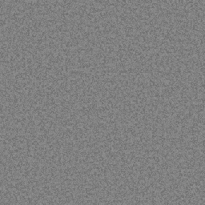<br><sub>плёнка 400 · прозрачная накладка</sub></td>
    <td align="center">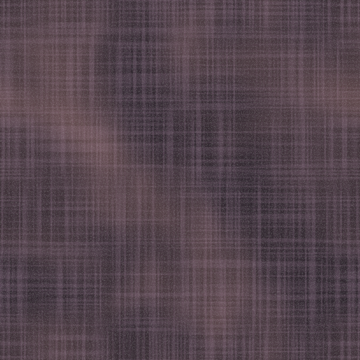<br><sub>шёлк · переливы</sub></td>
    <td align="center">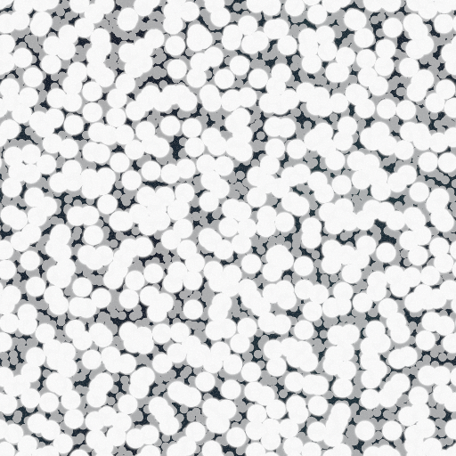<br><sub>звёздное поле</sub></td>
  </tr>
  <tr>
    <td align="center">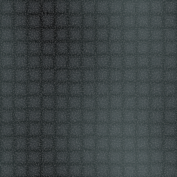<br><sub>карбон · плетение</sub></td>
    <td align="center">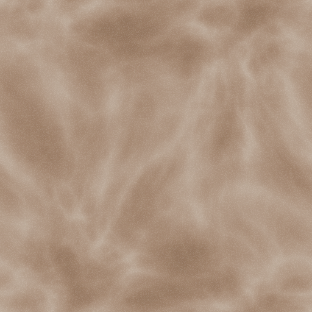<br><sub>дюны · песок</sub></td>
    <td align="center">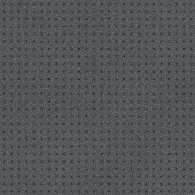<br><sub>стальная сетка</sub></td>
  </tr>
</table>

Подробности реализации, найденные ловушки и замеры — в [docs/how_it_made.md](docs/how_it_made.md).

## Скачать

Последняя сборка — в **[Releases](https://github.com/sibkit/zerno/releases/latest)**:

* `ZERNO-<версия>-windows-x64.zip` — приложение, библиотека пресетов и лицензии;
* `zerno.exe` — только приложение: один переносимый файл, без установщика.

**Требования:** Windows 11 или 10, 64 бита, процессор с SSE4.2 (любой за последние
~15 лет) и WebView2 Runtime — он уже есть в Windows 11 и в обновлённой Windows 10.
В Windows 10 полоса заголовка остаётся системного цвета, и приложение об этом сообщает.

Exe не подписан, поэтому при первом запуске SmartScreen может предупредить:
«Подробнее → Выполнить в любом случае».

## Сборка и запуск

Нужны Rust (нужная версия ставится сама по `rust-toolchain.toml`) и WebView2
Runtime (в Windows 10/11 он уже есть). Node и tauri-cli не нужны: интерфейс —
обычные файлы из `app/ui/`, они вшиваются в exe при сборке.

```
cargo build --release -p zerno     приложение: target/release/zerno.exe
cargo run --release -p zerno       собрать и запустить
```

```
engine/               движок (крейт zerno-engine), без зависимостей от Tauri
  src/noise.rs          решётки, Перлин / Value / Ворлей / зерно, искажение домена
  src/composite.rs      форма, цветовые таблицы, наложение, дизеринг
  src/color.rs          Oklab / OKHSL
  src/doc.rs            модель документа и строгий разбор JSON
  src/render.rs         пакетный рендер, кэш полей, формат ответа ZRN1
  src/bin/zerno-render.rs  рендер из командной строки (для сверки)
app/                  приложение (крейт zerno, Tauri 2)
  src/main.rs           команды render и engine_info, запуск
  src/files.rs          библиотека, открыть/сохранить, экспорт PNG/WEBP, настройки
  ui/                   интерфейс: index.html, css/, js/, fonts/
presets/              пресеты из комплекта
docs/how_it_made.md   как устроено, решения, ловушки, замеры
tests/                проверки на Node; tests/reference — эталонный движок на JS
tools/                make-presets.js (пресеты), make-icon.js (иконка),
                      make-readme-images.js (картинки для README в docs/images/)
```

## Работа

Оформление — тёмная тема в духе приложения Claude: тёплый графит, текст цвета
слоновой кости, терракотовый акцент; сплошные панели без зазоров, заголовки
обычным шрифтом. Полоса заголовка окна — в тех же цветах.

* **Живой рендер.** Плитка перерисовывается прямо во время перетаскивания
  ползунка: пока считается один кадр, правки копятся, и следующий кадр сразу
  берёт последнее состояние. Пропусков и устаревших кадров нет.
* **Отмена и повтор** — `Ctrl+Z`, `Ctrl+Y` (или `Ctrl+Shift+Z`), кнопки ↶ ↷.
  Перетаскивание ползунка — один шаг, а не сотня. Открытие пресета — тоже шаг:
  `Ctrl+Z` вернёт прежний документ вместе с его файлом.
* **Сессия** сохраняется сама: после перезапуска открыт тот же документ.
* **Файл документа.** Рядом с именем видно, с каким файлом связан документ, и
  точка, если есть несохранённые правки.
* **Справка** — окно внутри приложения: значок «?» у каждой группы параметров
  открывает её раздел, где объяснены все ползунки и их значения; `F1` или «?»
  справа вверху — начало справки, `Esc` закрывает. Всплывающих подсказок нет.

| клавиши | действие |
|---|---|
| `Ctrl+S` / `Ctrl+Shift+S` | сохранить / сохранить как… |
| `Ctrl+O` | открыть пресет (или бросить `*.json` на окно) |
| `Ctrl+E` | экспорт PNG |
| `Ctrl+Z` / `Ctrl+Y` | отмена / повтор |
| колесо над сценой, `Ctrl+=` / `Ctrl+-` | масштаб сцены |
| двойной клик по сцене, `Ctrl+0` | масштаб 1:1 |
| тянуть по числовому полю | менять значение; `Shift` — точнее, `Ctrl` — быстрее |
| `F1` | справка |

## Скорость

Пресет «тёмный холст», 3 канала, AMD Ryzen 7 5800H (16 потоков),
`cargo run --release -p zerno-engine --example bench`:

| плитка | правка цвета | пересчёт шума | было на Zig (пересчёт) | JS в браузере |
|---|---|---|---|---|
| 512² | **2.0 мс** | **10.8 мс** | 15.6 мс | 41 мс |
| 1024² | **7.7 мс** | **40 мс** | 52 мс | 266 мс |
| 2048² | **33 мс** | **154 мс** | 188 мс | — |

* **кэш шумовых полей** (до 256 МБ) — правка цвета, формы или режима
  наложения не пересчитывает шум вовсе;
* **пакетный рендер** — главная плитка и миниатюры всех каналов считаются
  одним вызовом, параллельно;
* **многопоточность** (rayon) — поле строится полосами строк, композит тоже;
* пиксели уходят в интерфейс двоичным буфером, без JSON и base64.

## Один алгоритм — эталон и движок

Движок на Rust — порт эталона на JS (`tests/reference`). Это проверяется
автоматически: оба считают все пресеты, результаты сверяются попиксельно.
Максимальное расхождение — **1 младший бит** (разный порядок округления
`f32`/`f64`). Дизеринг позиционный (зависит только от координат пикселя),
поэтому многопоточный расчёт даёт ровно ту же картинку, что однопоточный.

## Как устроена бесшовность

Каждое поле шума строится на решётке, у которой **число ячеек на плитку целое**.
Координата выборки `x = X · cells / W`, поэтому при `X = W` она равна ровно `cells` —
то есть ровно периоду решётки. Левый край плитки тождественно равен правому,
верхний — нижнему. Это выполняется для всех типов шума, для любого числа октав,
при искажении домена и при любом размере плитки, включая нечётный.

Свойство проверяется численно: средняя разность соседних столбцов на стыке
сравнивается с распределением таких же разностей внутри плитки. На стыке —
≈ 1× от 95-го процентиля (то есть ничем не выделяется), у заведомо непериодического
контрольного поля — 7×.

Вторая причина видимых полос — бэндинг при переводе в 8 бит. Его снимает дизеринг
(TPDF или Байер 8×8), причём шум не добавляется туда, где значение и так точно
ложится на 8-битный уровень: чистый чёрный и непрозрачная альфа остаются чистыми.

## Устройство документа

Плитка = **фон** (цвет без шума) + стопка **шумовых каналов** сверху вниз.
Каждый канал:

| | |
|---|---|
| **Шум** | тип, размер пятна по X и Y, сид, октавы, затухание, лакунарность, гребни, искажение домена |
| **Форма** | контраст, смещение, гамма, инверсия, нормализация диапазона |
| **Цвет** | градиент из двух цветов с альфой: «слабый» (шум = 0) → «сильный» (шум = 1) |
| **Слой** | режим смешивания (11 штук) и непрозрачность |

Типы шума:

* **Перлин** — облака, классический градиентный fBm;
* **Value** — мягче Перлина, менее «жилистый»;
* **Ворлей** — пятна и ячейки; режимы F1, F2, F2−F1 (трещины/сетка);
* **Зерно** — плёночное зерно; при ВЧ-фильтре > 0 становится «синим» шумом,
  который почти не даёт заметного повтора плитки.

У кнопок «+ канал» — миниатюра узора каждого типа. Карточка канала в свёрнутом
виде показывает миниатюру, краткую сводку и полоску градиента — по ней видно,
что делает канал, не раскрывая его; клик по карточке (стрелка справа)
разворачивает параметры.

**Размер пятна меняется ступенями.** Бесшовность требует целого числа ячеек на
плитку, поэтому размер — это всегда «сторона плитки / целое». Ползунок
логарифмический и встаёт ровно на ступени, а под подписью видно текущее число
ячеек. Чем крупнее пятно, тем реже ступени: на плитке 256 соседние размеры —
128 (2 ячейки) и 85.3 (3 ячейки), промежуточных нет.

### Цвет канала: градиент

В карточке канала цвета показаны полосой градиента с двумя ручками: слева
«слабый шум», справа «сильный шум». Клик по ручке открывает её редактор под
полосой, повторный клик — прячет; «⇄» меняет цвета местами.

### Цвет: два режима правки

В файле цвет всегда хранится в OKHSL (Björn Ottosson): H 0–360, S и L 0–1,
плюс альфа. Править его можно в одном из двух режимов, переключатель — в
заголовке любого редактора цвета, выбор запоминается:

* **HSL** (OKHSL) — при любых S и L цвет внутри гамута sRGB, клиппинга не бывает;
* **LCH** (OKLCH) — светлота, хрома и тон из Oklab: одинаковое L — одинаковая
  воспринимаемая яркость при любом тоне. Хрома ограничена гамутом sRGB: если
  при текущих L и H заданная C не помещается, она снижается до границы, и под
  ползунками об этом написано. Часть шкалы C за гамутом затемнена.

Рядом всегда есть поле HEX. Смешивание «низ → верх» по умолчанию идёт в OKLab
(перцептивно ровное, без грязных середин); переключается на линейный sRGB в
разделе «Вывод». Режимы наложения слоёв всегда считаются в линейном свете по
формуле композитинга W3C.

## Библиотека пресетов

Библиотека — любая папка с `*.json`, её выбирают кнопкой «Папка…»; выбор
запоминается (`%APPDATA%\com.sibkit.zerno\settings.json`). Подойдёт и `presets/`
из комплекта. Пока папка не выбрана, так и написано.

* клик по миниатюре открывает пресет и связывает документ с его файлом —
  `Ctrl+S` пишет прямо туда;
* «Сохранить как…» в эту папку сразу видно в библиотеке;
* крестик на миниатюре удаляет файл (с подтверждением), «↗» открывает папку
  в проводнике, «↻» перечитывает её;
* файлы с ошибками не пропадают молча: под заголовком — список с причинами,
  чужие `*.json` перечислены отдельно.

## Экспорт

* **PNG** — плитка как есть, с альфой (сделайте альфу фона < 1 для накладки);
  кодирует Rust, без участия WebView;
* **WEBP** — кодирует WebView2; качество 1.00 — без потерь;
* **CSS** — в буфер обмена уходит готовый блок с data-URI плитки и `background-repeat`.

Пресет — это сам документ: «Сохранить» / «Сохранить как…».

## Проверка стыковки глазами

Сцена замощена плитками целиком, центральная отмечена уголками. В панели над
ней: **«Границы»** рисует сетку по краям плиток, **«Сдвиг ½»** сдвигает
раскладку на половину плитки, чтобы стык оказался в центре, **«Сглаж.»**
включает сглаживание при увеличении. Масштаб 25–800 % — ползунок или колесо
над сценой, двойной клик — 1:1; рядом — цвет обрамления, чтобы судить фон на
светлом и тёмном. Сцена рисуется на canvas синхронно, поэтому при перетаскивании
ползунков картинка обновляется без мигания.

## Формат JSON

Разбор строгий и без умолчаний: отсутствующее поле, лишнее поле, неверный тип
или значение вне диапазона дают ошибку с точным адресом, например
`документ.channels[0].noise.shape.gamma: поле отсутствует (обязательное) [файл: my.json]`.
Интерфейс и движок проверяют документ одинаково и одинаковыми словами.
Файл всегда содержит полный набор полей, поэтому пресет переносится без потерь.

```json
{
  "format": "zerno-noise-tile",
  "version": 1,
  "name": "имя пресета",
  "tile": { "width": 512, "height": 512 },
  "render": {
    "stopMix": "oklab",
    "dither": { "mode": "tpdf", "amount": 1 },
    "webpQuality": 1
  },
  "background": { "h": 258, "s": 0.07, "l": 0.145, "a": 1 },
  "channels": [
    {
      "id": "clouds", "name": "Облака", "enabled": true,
      "blend": "normal", "opacity": 1,
      "noise": {
        "type": "perlin", "sizeX": 186, "sizeY": 186, "seed": 1337,
        "octaves": 4, "gain": 0.52, "lacunarity": 2, "ridged": false,
        "warpAmount": 38, "warpSize": 240,
        "worleyMode": "f1", "worleyJitter": 1, "grainHp": 3,
        "shape": { "contrast": 0.1, "bias": 0, "gamma": 1,
                   "invert": false, "normalize": true }
      },
      "low":  { "h": 266, "s": 0.24, "l": 0.04, "a": 0.34 },
      "high": { "h": 198, "s": 0.30, "l": 0.60, "a": 0.13 }
    }
  ]
}
```

Допустимые значения: `type` — `perlin | value | worley | grain`;
`worleyMode` — `f1 | f2 | f2f1`; `stopMix` — `oklab | srgb-linear`;
`dither.mode` — `tpdf | ordered | off`; `blend` — `normal, multiply, screen,
overlay, hard-light, soft-light, add, subtract, darken, lighten, difference`;
сторона плитки — 8…4096; сид — целое int32.

## Ограничения, о которых приложение говорит вслух

* Ячейка решётки мельче 2 px вырождает градиентный шум (у Перлина значение в узлах
  тождественно ноль), поэтому минимальное пятно для Перлина/Value/Ворлея — 2 px.
  Для попиксельного шума есть тип «Зерно», он рассчитан на 1 px.
* Число октав ограничивается сверху тем же правилом. Если запрошено больше,
  чем помещается, карточка канала показывает, до скольких октав ограничено и почему.
* Сид вне int32 не заворачивается молча — поле подсвечивается и объясняет.
* Если памяти на поле не хватило, рендер сообщает об этом, а не падает.

## Проверки

```
cargo test -p zerno-engine                    движок: стыковка, кэш, ошибки, каналы
cargo build --release -p zerno-engine         нужен для сверки (zerno-render.exe)
npm install                                   jsdom для проверок интерфейса
node tests/run-all.js                         эталон, пресеты, паритет Rust/JS, интерфейс
```

Проверка интерфейса идёт в jsdom: вместо приложения подставлена заглушка
`window.__TAURI__`, рендер в ней считает эталон на JS.

## Лицензия

[MIT](LICENSE) © 2026 sibkit.

Шрифты в комплекте — IBM Plex Sans, IBM Plex Mono и Unbounded — под
[SIL Open Font License 1.1](app/ui/fonts/OFL.txt).
